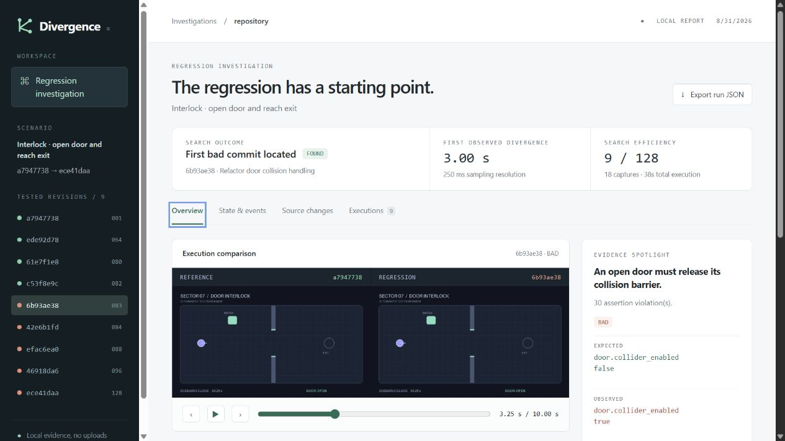

# Divergence

A local command-line tool that finds the revision where an interactive application's behavior broke. You give it a known-good revision, a known-bad revision and a repeatable scenario; it builds and replays the scenario on historical revisions in isolated checkouts, compares what each run did (state, events, logs, frames, metrics), and bisects to the first bad revision. The result is a self-contained HTML report that plays both executions side by side and links the runtime difference to the source change.

It works with Git, Perforce (including Unreal Engine projects on UGS), Unity Version Control and Subversion. Everything runs locally: no accounts, uploads or paid services.



## Key points

- **Four version-control providers.** Git first-parent history (with LFS and submodules), Perforce submitted changelists, Unity Version Control branch changesets, Subversion path revisions.
- **Isolation.** Every trial runs in a fresh checkout: a worktree of a private local clone for Git, a temporary cloned client for Perforce, a disposable workspace or checkout for UVCS and SVN. Your working copy and active Perforce client are never synced, reverted or cleaned.
- **Repeatable verdicts.** Each tested revision is replayed at least twice. Disagreement, missing evidence, build failures and timeouts are reported as inconclusive rather than bad.
- **Evidence you can check.** Captures are hashed, runs can be resumed, and reports embed their assets so they open without a server.
- **Optional learned classifier.** On a 48-example synthetic benchmark with held-out mutation families, a scikit-learn logistic regression reached F1 0.800 against 0.909 for the deterministic combined rules, so rules stay the default. See [docs/EVALUATION.md](docs/EVALUATION.md).
- **Tested.** 113 tests; CI on Windows, Linux and macOS with Python 3.11 and 3.12, plus a Linux Chromium job.

## How it works

```
scenario.yaml + good/bad revisions
  -> revision provider (Git / Perforce / UVCS / SVN): list candidates, check out one in isolation
  -> runtime adapter (command / browser / Unreal Automation): build, run the scenario, capture a trace
  -> comparison: state, events, logs, images, motion, metrics against the reference run
  -> verdict per revision (GOOD / BAD / INCONCLUSIVE) -> binary search
  -> HTML report with synchronized playback, failed assertions and the source diff
```

Adapters:

| Adapter | What it captures |
|---|---|
| Command | Any executable that writes the JSON trace protocol (Python/Pygame and Godot examples included) |
| Browser | Playwright with a controlled clock; DOM state, screenshots, WebM, recorded input replay |
| Unreal Automation | Results from `index.json` and editor logs |

Design notes: [docs/DESIGN.md](docs/DESIGN.md). Scenario format and trace protocol: [docs/ADAPTERS.md](docs/ADAPTERS.md).

## Tech stack

Python 3.11+, Typer, Pydantic, NumPy, Pillow, Playwright (optional), scikit-learn (optional), pytest, Ruff, GitHub Actions.

## Getting started

Requires Python 3.11+ and Git.

```sh
python -m venv .venv
# Windows: .venv\Scripts\activate    macOS/Linux: source .venv/bin/activate
python -m pip install -e .
divergence demo --run
divergence serve --open
```

`demo` generates a 128-commit Git repository with a door-collision bug introduced at commit 83 and searches it without reading the answer. The run finds the bug after testing 9 revisions. `serve` opens a read-only report browser at `http://127.0.0.1:8741`; reports are also written to `.divergence/runs/` and can be opened directly.

Other demos:

```sh
divergence demo --adapter browser --output browser-demo --commits 16 --bug-at 11 --run
divergence demo --adapter pygame --output pygame-demo --commits 16 --bug-at 11 --run
divergence doctor
```

The browser adapter needs `pip install -e ".[browser]"` and `python -m playwright install chromium`; Pygame needs `pip install -e ".[pygame]"`.

### On your own repository

```sh
divergence init --adapter command --output scenarios/open-door.yaml -- "{python}" tools/capture.py
divergence validate scenarios/open-door.yaml
divergence verify --repo /path/to/repo --revision v1.2.0 --scenario scenarios/open-door.yaml
divergence bisect --repo /path/to/repo --good v1.2.0 --bad HEAD --scenario scenarios/open-door.yaml
```

For Perforce and Unreal, start with `divergence perforce-check --repo <workspace>` and see [docs/PERFORCE_UGS.md](docs/PERFORCE_UGS.md). For UVCS and SVN see [docs/VERSION_CONTROL.md](docs/VERSION_CONTROL.md). Full command reference and options: [docs/USAGE.md](docs/USAGE.md).

## Development

```sh
python -m pip install -e ".[dev,ml,browser,pygame]"
python -m ruff check src tests tools
python -m pytest -q
```

Browser tests run only with `RUN_BROWSER_TESTS=1` after installing Chromium.

## Project layout

```
src/divergence/
  cli.py                     commands
  engine.py                  search, verification, resume
  revisions.py               Git and Perforce providers
  plastic_provider.py        Unity Version Control provider
  svn_provider.py            Subversion provider
  adapters/browser.py        Playwright adapter
  unreal.py                  Unreal Automation bridge
  evidence.py, oracle.py     comparison and verdicts
  fusion.py                  optional learned classifier
  report.py, ui/report.html  HTML report
  windows_job.py             Windows job objects for build and capture processes
  demo_templates/            demo apps (command, browser, Pygame, Godot)
tests/                       pytest suite
tools/                       end-to-end checks against real p4d, svn and TodoMVC, release packaging
docs/                        usage, adapters, version control, Perforce/UGS, design, evaluation
```

## Status and limitations

Alpha (0.3.0a1), not published to PyPI. It needs an application with a reproducible, instrumented scenario; it is not a debugger for arbitrary uninstrumented programs. Git searches follow first-parent history only, binary search assumes a regression stays bad once introduced (`--audit` checks every revision), and builds run trusted code with your permissions. See [SECURITY.md](SECURITY.md).

## License

Released under the MIT License. See [LICENSE](LICENSE).
